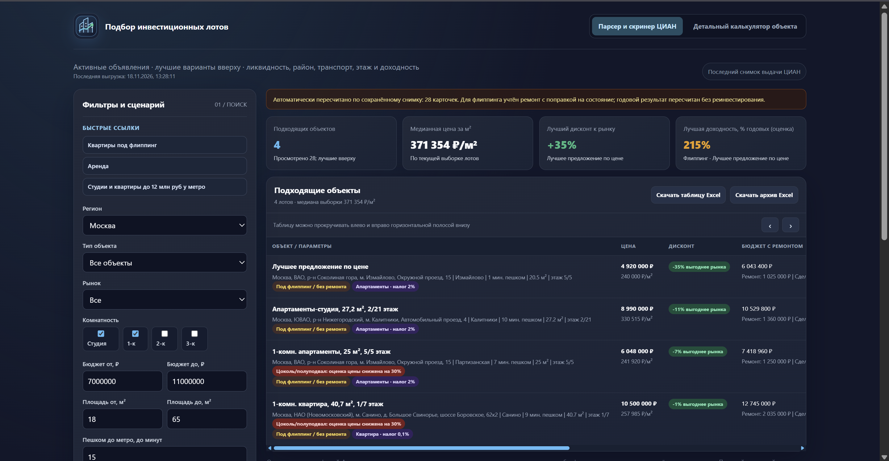
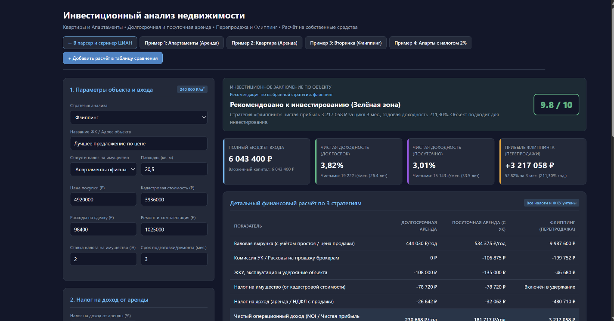
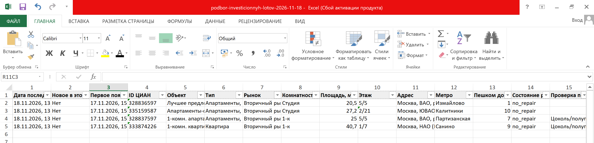

# Инвестиционный скринер ЦИАН

Локальный инструмент для ежедневного подбора и инвестиционного анализа квартир, студий и апартаментов на вторичном и первичном рынке Москвы и Московской области. Работает без API-ключей и без обхода защитных проверок сайта: данные берутся из выдачи, открытой обычным браузером, а расчёты выполняются на вашем компьютере.

Проект ориентирован на инвестора: в таблице показываются только объекты, прошедшие внутренний отбор (итоговый балл 9–10), отсортированные от более привлекательных к менее привлекательным. Сам числовой балл в интерфейсе не выводится.

**Все расчёты и инвестиционные рекомендации выполняются только на собственные средства: кредиты, ипотека, займы, рассрочки и платежи по ним в проекте не участвуют и не выводятся в результатах.** Ставки аренды, налога и ремонта к кредитам не относятся и учитываются в расчёте в полном объёме.

## Что умеет проект

- **Подбор лотов** по региону, типу недвижимости, рынку, комнатам, бюджету, площади, времени до метро, ремонту, этажу и району.
- **Три быстрых сценария**: «Квартиры под флиппинг», «Аренда», «Студии и квартиры до 12 млн руб у метро».
- **Расчёт трёх стратегий одновременно**: долгосрочная аренда, посуточная аренда, флиппинг (перепродажа после ремонта); в дашборде и калькуляторе можно выбрать стратегию для рекомендаций или оставить «лучшая из стратегий».
- **Учёт особенностей квартир и апартаментов**: разные ставки налога на имущество, коммерческие тарифы ЖКУ, налоги на аренду, правила безналоговой продажи.
- **Фильтрация рисков**: объекты с долями в праве собственности не показываются; первый этаж, цоколь и полуподвал получают отдельную проверку и корректировку оценочной стоимости.
- **Локальный дашборд** с KPI, горизонтальной таблицей, прокруткой по строкам и колонкам и переходами на объявление и в детальный калькулятор.
- **Экспорт в настоящий Excel** (`.xlsx`) — текущая выгрузка и отдельный архив уникальных объектов.
- **Архив без повторов**: новые объекты помечаются значком 🆕.
- **Детальный калькулятор объекта** в отдельной HTML-странице.
- **Интеграция с OpenCode**: агент, субагент и единый навык по работе с проектом.

## Состав проекта

| Путь | Назначение |
| --- | --- |
| `cian-parser-dashboard.html` | Основной дашборд: фильтры, быстрые ссылки, таблица результатов, кнопки выгрузки |
| `investment-calculator.html` | Детальный анализ одного объекта (аренда, флиппинг, точка безубыточности) |
| `dashboard-logo.svg` | Логотип дашборда |
| `start-parser.bat` | Запуск локального сервера и открытие дашборда (Windows) |
| `parser/server.js` | Локальный HTTP-сервер: приём карточек из расширения, фильтрация, сортировка, API, экспорт |
| `parser/cian-scraper-core.js` | Ядро: разбор карточек, скоринг, ликвидность, этажи, район, метро, расчёт аренды и флиппинга |
| `parser/excel-export.js` | Генерация файлов `.xlsx` без внешних Excel-библиотек (на базе `fflate`) |
| `parser/listings-archive.js` | Архив уникальных объектов и отметки новых |
| `parser/sync-live-data.js` | Синхронизация сохранённых снимков выдачи |
| `chrome-extension/cian-collector/` | Расширение для Яндекс Браузера / Chrome: сбор видимых карточек с открытой страницы ЦИАН |
| `data/cian-parsed-results.json`, `.csv` | Последняя выгрузка (пример данных) |
| `data/objects-comparison-template.csv` | Шаблон сравнения объектов для Excel |
| `Архив/объекты.json`, `.csv` | Архив всех найденных уникальных объектов |
| `Справка по быстрым ссылкам/` | Описания трёх быстрых сценариев |
| `templates/` | Анкета объекта, шаблон отчёта, чек-лист проверки перед сделкой |
| `reports/` | Пример готового инвестиционного разбора |
| `step-by-step-guide.md` | Пошаговая инструкция для пользователя без программирования |
| `AGENTS.md` | Правила работы и методические ограничения проекта |
| `.opencode/agents/`, `.opencode/skills/` | Агент, субагент-исследователь и навык по работе с проектом для OpenCode |
| `opencode.json` | Конфигурация MCP-серверов OpenCode (локальный путь к Node.js нужно адаптировать на другой машине) |

## Быстрый старт

### 1. Подготовьте окружение

- Windows;
- Node.js 20 или новее (проверка: `node --version`);
- Яндекс Браузер или Google Chrome;
- зависимости проекта.

В папке проекта выполните:

```powershell
npm install
```

Если есть `package-lock.json`, можно `npm ci`.

### 2. Запустите локальный сервер

Двойным щелчком запустите `start-parser.bat`. Либо вручную:

```powershell
node parser/server.js
```

Чёрное окно сервера должно оставаться открытым. После перезапуска компьютера запустите `start-parser.bat` снова.

### 3. Откройте дашборд

```text
http://localhost:3456/cian-parser-dashboard.html
```

Если данных ещё нет, таблица будет пустой — это нормально: нужно собрать карточки через расширение.

## Установка расширения для сбора карточек

1. Откройте в браузере `browser://extensions` (Яндекс Браузер) или `chrome://extensions` (Chrome).
2. Включите **«Режим разработчика»**.
3. Нажмите **«Загрузить распакованное расширение»**.
4. Выберите папку `chrome-extension/cian-collector` внутри проекта.
5. Убедитесь, что расширение называется **«ЦИАН → Инвест-скринер»**.

Расширение работает только с текущей открытой страницей выдачи ЦИАН. Оно читает видимые карточки и передаёт их локальному серверу на `http://localhost:3456`.

## Ежедневный рабочий процесс

1. Запустите `start-parser.bat`, дашборд откроется автоматически.
2.Выберите один из трёх быстрых сценариев или настройте фильтры вручную.
3. 
6. Внизу дашборданажмите **«Открыть выдачу ЦИАН»** — ссылка откроется в новой вкладке.
7. Если ЦИАН запросит проверку, пройдите её **вручную**.
10. В верхнем правом углу нажмите расширение **«ЦИАН → Инвест-скринер»** → **«Собрать текущую страницу»**.
11. 
12. 
13. Данные в дашборде появятся автоматически, а расчёт с учётом ремонта выполнится сразу.
14. Для следующей страницы выдачи перейдите на неё вручную и повторите сбор.
15. Подробный калькулятор объекта по кнопке "В калькулятор"
16. 
17. При необходимости нажмите **«Скачать таблицу Excel»** или **«Скачать архив Excel»**
18. 


## Быстрые сценарии

| Сценарий | Параметры |
| --- | --- |
| Квартиры под флиппинг | Москва; вторичка; студии, 1–2 комнаты; до 12 000 000 ₽; 18–65 м²; метро ≤ 10 мин; только «требует ремонта»; любой этаж; сортировка по доходности флиппинга |
| Аренда | Москва; квартиры и апартаменты; вторичка; студии, 1–2 комнаты; до 11 000 000 ₽; 18–65 м²; метро ≤ 10 мин; косметический или евроремонт; не первый этаж; сортировка по доходности аренды |
| Студии и квартиры до 12 млн руб у метро | Москва; квартиры и апартаменты; вторичка и новостройки; студии, 1–3 комнаты; до 12 000 000 ₽; 18–65 м²; метро ≤ 10 мин; любой ремонт; не первый этаж; сортировка по минимальной цене за м² |

## Настройки инвестора

Значения по умолчанию заданы в дашборде:

| Параметр | Значение |
| --- | --- |
| Стоимость ремонта | 50 000 ₽/м² |
| Цикл флиппинга | 3 месяца |
| Расходы на сделку при покупке | 2% от цены |
| Загрузка посуточной аренды | 70% |
| Комиссия при продаже | 2% |
| Налог при продаже | 13% |
| Премия за свежий ремонт при продаже | 5% |

Все параметры можно изменить в левой панели фильтров; они сразу влияют на пересчёт.

## Методика расчёта

### Общая логика

Для каждого объекта рассчитываются три стратегии. В рекомендациях учитывается выбранная стратегия (в дашборде и калькуляторе — поле выбора стратегии); если стратегия не выбрана, используется лучшая из трёх по рассчитанной доходности. Внутренний инвестиционный балл складывается из ликвидности (55%) и финансовой привлекательности (45%) по той стратегии, которая принята для рекомендации. В таблицу попадают только объекты с баллом от 9; сам балл пользователю не показывается.

### Долгосрочная аренда

```text
Валовая годовая аренда = месячная аренда × 12
Чистая годовая аренда = валовая × (1 − ставка налога) − ЖКУ × 12 − налог на имущество
Чистая доходность = чистая годовая аренда / вложения × 100%
```

Вложения = цена покупки + расходы на сделку + ремонт (если объект требует ремонта).

### Посуточная аренда

```text
Валовая годовая выручка = дневная ставка × 365 × загрузка (70%)
Чистая годовая выручка = валовая × (1 − комиссия сервиса и налог) − ЖКУ × 12 − налог на имущество
```

Дополнительно учитываются простои и амортизация меблировки.

### Флиппинг

**Ремонт учитывается всегда**, независимо от заявленного состояния объекта. Сумма зависит от состояния:

| Состояние | Доля от ставки ремонта |
| --- | --- |
| Без ремонта | 100% |
| White box / предчистовая | 65% |
| Косметический ремонт | 40% |
| Евроремонт / свежий ремонт | 20% |

```text
Вложения во флиппинг = цена покупки + расходы на сделку + ремонт с поправкой на состояние
Ожидаемая цена продажи = площадь × 75-й перцентиль цены м² готовых объектов × (1 + 5%) × поправка на этаж
Налогооблагаемая прибыль = цена продажи − вложения − удержание − комиссия риелтора
Чистая прибыль = прибыль до налога − 13% налога
ROI за цикл = чистая прибыль / вложения × 100%
Годовая доходность = ROI за цикл × 12 / месяцы цикла
```

Годовая доходность считается **без реинвестирования** — простая пролонгация цикла, без сложного процента.

### Квартиры и апартаменты

| Параметр | Квартира | Апартаменты |
| --- | --- | --- |
| Налог на имущество | 0,1–0,3% кадастровой стоимости (вычет 20 м²) | 0,5% или 1,5–2,0% без вычета |
| ЖКУ | Жилые тарифы + взнос на капремонт | Коммерческие тарифы, в расчёте на 25% выше |
| Налог на аренду | НПД (самозанятость) 4% / 6% | ИП УСН 6% или НДФЛ 13–15%; НПД не применяется |
| Продажа без налога | 3 года (единственное жильё) или 5 лет | 5 лет; при использовании в бизнесе ИП налог возникает независимо от срока |
| Налоговый вычет при покупке | До 260 000 ₽ + до 390 000 ₽ по процентам | Не предусмотрен |

### Этажи и риски

- Объекты с долями в праве собственности отфильтровываются.
- Обычный первый этаж только помечается на проверку.
- Если в описании указаны **цоколь или полуподвал**, оценочная цена снижается на 30%, и это влияет на расчёт доходности.
- Доступны варианты этажа: «любой», «кроме первого», «кроме первого и последнего».

## Экспорт и архив

- **«Скачать таблицу Excel»** — текущая выгрузка с расчётами.
- **«Скачать архив Excel»** — все уникальные объекты, найденные за время работы.
- В архиве нет дублей; новых объектов помечены 🆕.
- Файлы `.xlsx` создаются локально и открываются в Excel.

## Ограничения и принципы

- Проект **не использует API ЦИАН** (он доступен преимущественно для юридических лиц) и не требует ключей.
- Проект **не обходит CAPTCHA и блокировки**: проверку пользователь проходит сам в обычном браузере.
- Расширение не листает страницы автоматически — сбор выполняется по каждой странице вручную.
- Объявления могут сниматься с публикации: перед сделкой проверяйте ссылку.
- Расчёт дистанционной аренды и цены продажи — оценочный; итоговое решение принимает инвестор.
- Расходы на сделку в скринере упрощено составляют 2% от цены покупки, это не детальная смета.
- Сервер работает только локально на `localhost:3456`.

## Устранение неполадок

| Симптом | Что проверить |
| --- | --- |
| Дашборд не открывается | Запущен ли `start-parser.bat`; свободен ли порт 3456 |
| Расширение не видит карточки | Открыта ли выдача ЦИАН; нажата ли кнопка сбора; обновлено ли расширение после изменений |
| Таблица пуста | Прошли ли объекты внутренний отбор; не отсекают ли фильтры все карточки |
| Старые цифры в таблице | Обновите страницу дашборда (`Ctrl+F5`) |
| MCP-серверы OpenCode не стартуют | В `opencode.json` указан абсолютный путь к Node.js — замените на путь вашей машины |

## Интеграция с OpenCode

В проекте есть:

- `AGENTS.md` — роли, правила работы и ограничения;
- `.opencode/agents/cian-parser.md` — агент парсинга и скоринга;
- `.opencode/agents/market-researcher.md` — субагент поиска рыночных аналогов;
- `.opencode/skills/cian-screener-project/SKILL.md` — единый навык: структура, запуск, внесение изменений, проверки, README и публикация.

Отчёты сохраняются в `reports/`, сравнительные таблицы — в `data/`.

## Лицензия

Лицензия не указана. Все права на код и методику принадлежат автору проекта.
